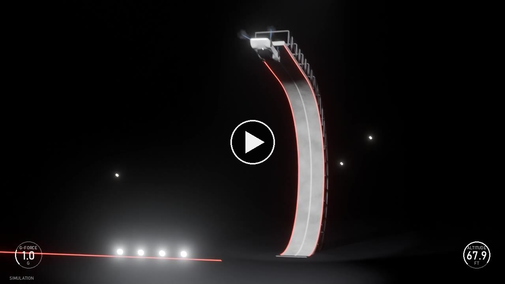

# Tesla Roadster wall flip — simulation

A physics simulation and a Blender render of the first flying stunt at the Tesla Roadster event on 2026-10-15.
The car drives up a curved wall, rides the 170° overhang upside down, lets go at about 52.25 s, rolls upright
in the air, and lands on its cold-gas thrusters at about 56.3 s. Every dimension of the wall and the car comes from
measurements of the event video (the broadcast HUD and calibrated camera views), or from press reports.

*Click the image to open the video page (broadcast cut with HUD and sound, broadcast cut, coverage cut).*

**Live pages (GitHub Pages):** <https://az9713.github.io/roadster-physics/>

- [`index.html`](https://az9713.github.io/roadster-physics/) — the three draft videos in browser players.
- [`PROJECT.html`](https://az9713.github.io/roadster-physics/PROJECT.html) — the project document: all
  measurements, sources, the model, and the change log.
- [`replay.html`](https://az9713.github.io/roadster-physics/replay.html) — interactive 3D replay (Three.js).
- [`PHYSICS.html`](https://az9713.github.io/roadster-physics/PHYSICS.html) — the physics report: the complete theory
  with derivations, every parameter with its status (measured, published, derived, est.), and the results against the HUD.
- [`DEVELOPMENT-JOURNEY.html`](https://az9713.github.io/roadster-physics/DEVELOPMENT-JOURNEY.html) — how it was
  built, from the first prompt to this site: the videos, the measurements, the physics, Blender, what went wrong, and
  the unknown unknowns.

The videos are renders of the simulation (Blender EEVEE drafts, 1280x720). They are not real footage.

## Source videos

### Primary source: PCMag (yes, this one is the basis)

**"Tesla Rolls Out a Flying Roadster: See All the Highlights"** — PCMag —
<https://www.youtube.com/watch?v=quRC56Z0EJw> (10:14)

The target of the simulation is the flip run at **1:41–2:00** in this video. It is the event's live broadcast feed.
It gives:

- **The two broadcast camera shots.** Camera A is a long lens (about 295 mm) about 62 m behind the wall foot. Camera B
  is a tripod at about (−76.9, −18.4, 7.7) m. Both are calibrated against wall edges in PCMag frames
  (`blender/calib_cameras.py` → `out/camera_calib.json`; rms 4.1 px and 5.6 px). The Blender `broadcast` cut uses
  these two cameras.
- **The HUD gauges during the flip run** (G-FORCE and ALTITUDE), read frame by frame into `data/hud_wall_flip.csv`.
- **The reference frames** for the look of the render (`frames/ref/pcmag_*.png`) and the shot-B frames used to
  triangulate the car after release (`frames/tri/b/`, PCMag 113.6–117.6 s).

### Same feed, used for the time base and two more measurements: VideoFromSpace

**"Tesla Unveils 'Flying' Roadster with SpaceX Thrusters"** — VideoFromSpace —
<https://www.youtube.com/watch?v=eqOfmtTJD1A> (16:41)

This is the same live feed. The flip run is at 0:40–0:59 here. Time conversion: **PCMag time = VideoFromSpace time
+ 61.35 s** (measured from the gauge readings). The simulation clock is the VideoFromSpace clock, so PCMag =
sim + 61.35 s. This video gives two items that the PCMag cut does not show in full:

- **The first, slow climb (0:05.5–0:27).** Its HUD shows PITCH (deg), ALTITUDE (ft) and DOWNFORCE (kg). The wall
  profile is rebuilt from it: horizontal step dx = dh / tan θ (`data/wall_profile_hud.csv`). No source publishes
  the wall dimensions.
- **The slow-motion replay R1** (about 1:09–1:20), the second view for the triangulation (`frames/tri/r1/`).

### Secondary sources

| Video | Channel | Used for |
|---|---|---|
| [New Tesla Roadster: SpaceX Thrusters, 0.6sec 0-60mph & 330mph! \| 4K](https://www.youtube.com/watch?v=JdkIOhFmbKI) (49:13) | Top Gear | Car specifications: wheelbase 2,825 mm, width 2.0 m, tyres, mass target, drive, nozzle layout, gas tanks |
| [特斯拉 Roadster 飛天跑車發表會 [正體中文字幕]](https://www.youtube.com/watch?v=woW6MWs3hKs) (21:18) | Will 保哥 | Extra angles of both stunts (wall flip about 3:27–5:33; second stunt 8:42–9:26) |
| [ロケット技術を搭載したテスラ新型「ロードスター」を発表](https://www.youtube.com/watch?v=XtKcl8iaJ7I) (2:28) | テレ東BIZ ダイジェスト | Cross-check of the event |

Press reports (Electrek, TechCrunch, CBS News, Tech-Insider) are listed with the facts taken from each in
`PROJECT.html` §6. Captions and clean transcripts of the videos are in `video_sources/`. The video files are not in
this repository.

## What is in the repository

| Path | Content |
|---|---|
| `sim/wall_flip_sim.py` | Wall rebuild from the HUD, on-wall physics, 6-DOF flight with 10 nozzles, tank and landing. Writes `out/replay_data.js` and prints a self-check. `python sim/wall_flip_sim.py short` uses the short-overhang variant. |
| `data/` | HUD readings (CSV). |
| `out/physics/` | Charts for `PHYSICS.html` and `make_charts.py`, which makes them and prints every derived number in the report. |
| `blender/` | Scene, car model, camera calibration, triangulation, HUD overlay and mux. Run Blender 5.2 with `--factory-startup`. |
| `out/*.mp4` | Draft videos: `coverage_draft.mp4` (20.5 s), `broadcast_draft.mp4` (13.97 s), `broadcast_draft_hud.mp4` (13.97 s, HUD + sound). |
| `out/sfx/` | ElevenLabs sound-effect takes and `mix.py`, which mixes them to the sim. |
| `frames/`, `evidence/` | Stills from the source videos, used as measurement references. |
| `check.py`, `claims.csv` | The claim checker and its registry: every number in `PROJECT.html`, `PHYSICS.html` and this file, with the script and output line that produce it and an evidence class (HUD, footage, model-only, none). |
| `HANDOFF.md` | Resume notes for the next work session. |

## Status and known limits

- The simulation is done and its self-check passes. The 3D replay and the EEVEE drafts are done. The Cycles final of
  the broadcast cut is `out/broadcast_final.mp4` (with HUD and sound: `out/broadcast_final_hud.mp4`).
- `python check.py` reruns the sim and the two physics scripts and compares the published numbers with their output
  (registry: `claims.csv`). The pre-commit hook runs `python check.py --fast`.
- The flight after release is planar (y = 0). The triangulation of the real car path did not reach its accuracy
  limit (≤ 5 px; best result 76 px in R1, 50 px in shot B), so the sim was not refitted. In the images, the real car
  drifts sideways to +y. `out/triangulation.json` is not valid.
- The overhang length has two variants (`hud`, the default, and `short`). The evidence for each is in `PROJECT.html` §9.

Stills and captions from the source videos are the property of their channels. They are here only as measurement
references.
